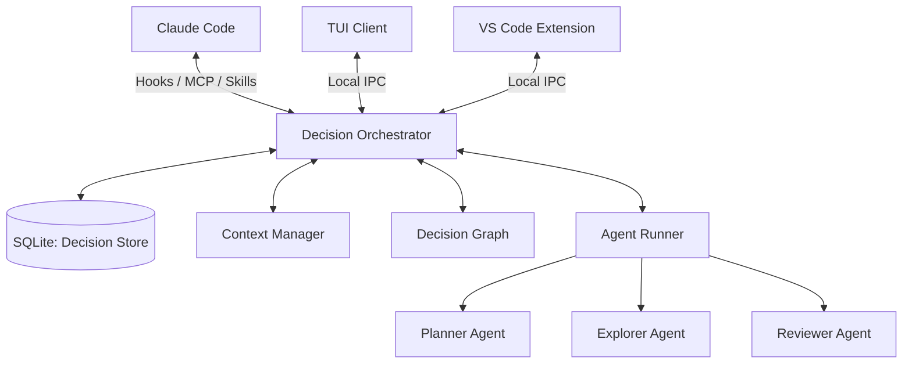

# Claude Code向け Decision Workspace 設計案

> 作成日: 2026-11-13  
> ステータス: 初期構想・要件整理  
> 目的: LLMとのやり取りで大量の選択肢が一度に提示される問題を解消し、意思決定を1件ずつ処理しながらコンテキストの肥大化を防ぐ。

## 1. 概要と設計方針

**LLMの会話を質問の置き場所にしない。**

質問・選択肢・回答・判断理由を外部に保存し、ユーザーはTUIまたはVS Code拡張で1件ずつ判断する。Claude Codeは必要な局面だけ質問・決定結果にアクセスする。

基本方針:

- Claude Code専用から始める。
- 通常のClaude Code操作に自動介入する仕組みを目指す。
- 質問は一括提示せず、論点一覧を作り、個々の論点で選択肢を具体化する。
- 決定事項・根拠・制約・未解決事項だけを親エージェントに返す。
- 深掘りは独立コンテキストのサブエージェントまたは独立セッションで実施する。
- TUIとVS Code拡張は同じ状態管理基盤を共有する。

## 2. 参考にする既存ツール

| プロジェクト                                                                                                  | 参考にする機能                                              | 追加で実装したい部分          |
| ------------------------------------------------------------------------------------------------------------- | ----------------------------------------------------------- | ----------------------------- |
| [AUQ — Ask User Questions](https://github.com/paulp-o/ask-user-questions-mcp)                                 | 質問キュー、CLI/TUI操作、複数エージェント接続、補足説明依頼 | 依存関係、決定履歴、自動介入  |
| [Human in the Loop MCP](https://marketplace.visualstudio.com/items?itemName=DercasDrol.human-in-the-loop-mcp) | VS Codeサイドバー、通知、回答履歴                           | TUIとの共通状態、論点の深掘り |
| [QuizGate](https://marketplace.visualstudio.com/items?itemName=quizgate.quizgate)                             | エディタ内の質問パネル                                      | 質問ツール未使用時の自動検出  |
| [AskHuman](https://github.com/Naituw/AskHuman)                                                                | 外部通知、回答の返送                                        | 多段階の意思決定              |
| [Agent Stream](https://marketplace.visualstudio.com/items?itemName=keithfajardo.agent-stream)                 | ステップ・依存関係・承認管理                                | 論点ごとの検討・再利用        |

これらの機能の実際の動作、ライセンス、継続メンテナンス状況は実装着手前に再確認する。

## 3. 全体アーキテクチャ



Orchestratorは**非LLMの決定的な状態管理プロセス**を基本とする。LLMは質問の抽出、深掘り、依存関係の影響評価など、必要なときだけ呼び出す。

### 役割

- **Decision Queue**: 質問・回答待ち・保留・決定済みを保持する。
- **Decision Graph**: 論点の依存関係を保持し、回答変更の影響を追跡する。
- **Context Manager**: 決定結果・理由・制約だけを要約し、必要なセッションへ渡す。
- **Session Router**: 質問の発生元セッションと、回答を受け取る先を管理する。
- **Event Engine**: HooksやMCPによる質問検出・通知・更新を処理する。

## 4. 自動介入

通常のClaude Codeでユーザーが特別なコマンドを打たなくても、質問や選択肢を検出してDecision Workspaceに回すことを目指す。

### レベル1: 既存質問ツールの捕捉

- `PreToolUse`で`AskUserQuestion`の利用を検出する。
- 質問をDecision Queueに保存し、UIで回答を受け付ける。
- 回答をClaude Codeへ返す。
- 公式Hooksの実際の入力変更・ブロック・応答方式は実装時に検証する。

### レベル2: 通常応答からの質問検出

- `MessageDisplay`など、利用可能なHookイベントで通常応答を検査する。
- 「A/B/Cから選ぶ」「どちらにするか決める」など意思決定要求を抽出する。
- 単なる比較・説明を誤検出しないよう、ユーザーへの決定要求かどうかも判断する。
- **注意**: 表示上の置換と、Claude内部の会話履歴の削減は別。通常応答を検出するだけでは完全なコンテキスト分離にならない。

### レベル3: 応答終了時の介入

- `Stop`で未処理の意思決定を検査し、必要に応じてキューへの登録を促す。
- 無限ループや意図しない作業の停止を防ぐ。
- 最初は自動捕捉・通知にとどめ、強い介入は設定で有効にする。

### 介入の限界と別モード

文章としてLLMが選択肢を生成してから介入する方式では、生成前の制御や内部コンテキスト削除は保証できない。厳密なセッション・出力制御を実現する場合は、Claude Agent SDKを使って実行全体を管理する**Managedモード**を別途検討する。

## 5. Decision Graph

質問を単なるフラットなリストではなく、依存関係のあるグラフで管理する。

例:

```text
D-001 データはどこに保存する？
  ├─ クラウド利用あり → D-002 同期方式は？
  └─ ローカル利用あり → D-003 ローカルDBは？
```

- 決定によって不要な質問をスキップする。
- 決定を変更したら依存先を`Revisit`にする。
- 過去の決定や理由を消さず、リビジョン履歴を残す。
- 循環依存を防ぐ。
- 後続の質問は依存する回答に応じて再生成・更新できる。

### 状態モデル案

| 状態      | 意味                                   |
| --------- | -------------------------------------- |
| Pending   | 未検討                                 |
| Exploring | サブエージェントが検討中               |
| Ready     | 選択肢が準備できた                     |
| Decided   | 決定済み                               |
| Revisit   | 前提変更により再確認が必要             |
| Skipped   | 条件不一致またはユーザー判断でスキップ |
| Cancelled | 取り消し                               |

## 6. サブエージェント

### Planner Agent

要求から意思決定が必要な論点と依存関係を抽出する。最初からすべての選択肢を確定させず、**論点の一覧**を作る。

### Explorer Agent

現在の論点を調査・比較し、選択肢・推薦理由・トレードオフを構造化して出力する。「深掘り」は独立コンテキストで行う。

### Reviewer Agent

回答同士の矛盾を検出し、後続の論点への影響を評価する。必要な場合にDecision Graphの更新を提案する。

### コンテキスト分離

- 長い検討履歴は外部保存する。
- 親のClaude Codeには、結論・理由・重要制約・未解決事項だけを渡す。
- サブエージェントの全出力を親へ転送しない。
- 独立したセッションをOrchestratorから起動する方法も採用可能にする。
- **留意点**: 親の既存会話履歴まで短縮されるとは限らない。トークン削減量は計測で検証する。

## 7. UI要件

### 共通の画面

- **Current**: 現在の意思決定を1件表示する。
- **Queue**: 待機中・保留中・決定済みの論点一覧。
- **History**: 決定理由、変更履歴、影響先。
- **Deep Dive**: 必要に応じて独立サブエージェントへ追加質問する。

### 入力タイプ

- 単一選択
- 複数選択
- 自由入力
- その他・追加案を依頼
- 保留・スキップ
- 前の質問へ戻る・再検討

### TUI操作例

| キー      | 動作             |
| --------- | ---------------- |
| `j` / `k` | 移動             |
| 数字キー  | 選択肢を選ぶ     |
| `Enter`   | 決定             |
| `Tab`     | 論点切替         |
| `d`       | 深掘り           |
| `u`       | 再検討           |
| `?`       | キーボードヘルプ |

VS Code拡張は同じOrchestratorに接続する薄いUIとし、サイドバー、通知、論点グラフ、検討履歴を提供する。

## 8. 技術スタック案

| レイヤー      | 候補                                    | 理由                                    |
| ------------- | --------------------------------------- | --------------------------------------- |
| Core / Daemon | TypeScript + Node.js                    | Claude連携とVS Code拡張で共通化しやすい |
| TUI           | OpenTUI                                 | 高度なキーボード主体UI                  |
| VS Code       | Extension API + Webview                 | サイドバーを自由に設計できる            |
| DB            | SQLite                                  | ローカル完結・トランザクション          |
| Claude連携    | Hooks + MCP                             | 通常Claude Codeとの統合                 |
| 深掘り実行    | Claude Agent SDK                        | 独立セッション・エージェント制御        |
| IPC           | Unix Domain Socket / Windows Named Pipe | 同一端末内で低オーバーヘッド通信        |
| スキーマ      | Zod                                     | 型と入出力検証                          |

GoやRustも選択肢だが、最初はTypeScriptで統一する案を優先する。

### リポジトリ構成案

```text
decision-workspace/
├── apps/
│   ├── cli/
│   ├── vscode/
│   └── daemon/
├── packages/
│   ├── core/
│   ├── protocol/
│   ├── storage/
│   ├── claude-hooks/
│   ├── claude-mcp/
│   ├── agent-runner/
│   └── detection/
├── agents/
│   ├── planner.md
│   ├── explorer.md
│   └── reviewer.md
└── tests/
    ├── unit/
    ├── integration/
    └── e2e/
```

## 9. データモデル案

```json
{
  "decision": {
    "id": "D-003",
    "projectId": "app-project",
    "title": "データ保存方式",
    "status": "ready",
    "question": "どの保存方式を採用するか？",
    "options": [
      {
        "id": "sqlite",
        "label": "SQLite",
        "recommended": true,
        "reason": "オフライン運用に適する"
      },
      {
        "id": "swiftdata",
        "label": "SwiftData",
        "recommended": false
      }
    ],
    "dependsOn": ["D-001"],
    "decision": null,
    "rationale": null,
    "revision": 1,
    "sourceSessionId": "session-123"
  }
}
```

実際のSQLite実装では、Decision、Option、Dependency、Revision、Session、AgentRun、Eventを必要に応じて正規化する。確定処理はトランザクションで実行し、同時操作は楽観ロック等で競合検出する。

## 10. 自動検出のパイプライン

```text
Claudeからの質問・応答
    ↓
ルールベースの候補検出
    ↓
必要な場合だけLLMで意思決定要求か判定
    ↓
既存Decisionとの重複・依存関係を照合
    ↓
Decision Queueへ登録
    ↓
TUI / VS Codeへ通知
```

重要な判定基準は、**選択肢が列挙されているか**ではなく、**ユーザーに意思決定を求めているか**。比較説明、コード例、単なる箇条書きを無差別に質問化しない。

初期段階では検出・通知のみとし、検出精度が十分なら自動中断・自動再開をオプション化する。

## 11. 開発ロードマップ

### Phase 1 — Decision Core + TUI

- SQLite状態管理
- 質問の登録、表示、回答、保留、戻る
- 単一選択・複数選択・自由入力
- 履歴と中断再開
- キーボード主体のTUI

### Phase 2 — Claude Code連携

- `AskUserQuestion`のHook連携
- MCPでの登録・取得・回答返送
- セッション識別と再接続
- Hook異常時のフェイルセーフ

### Phase 3 — Decision Graph + Subagents

- 依存関係・条件分岐・再検討
- Planner / Explorer / Reviewer
- 深掘りを独立セッションで実行
- 決定事項と根拠のコンテキスト圧縮

### Phase 4 — 自動介入

- 通常の文章から意思決定要求を検出
- 重複・誤検出の防止
- 通知から自動制御へ段階的に拡張
- Managedモードの実現可能性を検証

### Phase 5 — VS Code拡張

- サイドバーUI
- 共通Daemonとの同期
- 論点グラフと履歴
- 通知と詳細検討画面

## 12. テスト・非機能要件

- 10件の質問を途中まで処理してClaudeを再起動しても復旧する。
- TUIとVS Codeで同時に操作しても二重確定しない。
- 依存する質問の前提が変わっても過去の決定履歴を維持する。
- Hookのタイムアウトや異常終了時に通常のClaude Code操作を妨げない。
- 深掘りの履歴が親Claudeのコンテキストへ無制限に流入しない。
- 誤検出時に普通の回答を破損しない。
- IPCをローカル限定で保護し、必要に応じて認証する。
- 秘密情報をログに残さない。
- 外部からの文章は命令ではなく、判定対象データとして扱う。
- セッション・サブエージェント起動回数、トークン消費量、コンテキストサイズ、回答までの操作回数を計測する。

## 13. 発展機能

### Decision Diff

決定の変更前後と影響する論点を表示する。

### Decision Presets

技術選定などの意思決定を他プロジェクトへ再利用する。

### Decision Export

確定事項をMarkdown、ADR（Architecture Decision Record）等に出力してGit管理できるようにする。

## 14. 開発時の主要な設計判断

| 項目         | 推奨方針                                            |
| ------------ | --------------------------------------------------- |
| 対象         | まずClaude Code専用                                 |
| 中核         | 非LLMのDecision Orchestrator                        |
| 開発言語     | TypeScript                                          |
| UI           | OpenTUI + VS Code Webview                           |
| 保存先       | SQLite、プロジェクト単位                            |
| Claude連携   | Hooks + MCP                                         |
| 深掘り       | Claude Agent SDK、独立セッション                    |
| コンテキスト | 決定結果・根拠・制約のみ親へ返す                    |
| 自動介入     | 専用質問ツールから始め、自然言語検出を追加          |
| 独自性       | Decision Graph + Context Isolation + Auto Detection |

### 互換モードとManagedモード

- **Compatibility Mode**: ユーザーは普段どおりClaude Code CLIを使い、Hooks/MCP経由で連携。導入しやすい一方、元の会話履歴は完全には制御できない。
- **Managed Mode**: Claude Agent SDKでClaudeの実行ループやセッションをOrchestrator側で管理。自由度は高いが、ツールの権限・セッション・UIを管理する責任が増す。

最初はCompatibility ModeをMVPとし、Managed Modeを追加できる内部APIを目指す。

## 15. 残る検証・未確定事項

1. Claude Code Hooksの現行仕様（`MessageDisplay`、`PreToolUse`、`Stop`等）と制御可能範囲。
2. `AskUserQuestion`の質問・回答をHookでどう変換・返却するか。
3. Claude Agent SDKでの独立セッション起動とトークンコスト。
4. OpenTUIの動作環境、安定性、Windows対応。
5. AUQなどを参考・再利用する際のライセンス条件。
6. Claudeの通常文章を検出する場合、どのタイミングでテキストを安全に取得できるか。
7. VS Code拡張の前に、Daemonの常駐・自動起動・復旧方式をどこまで整備するか。

---

## 参考資料

- [AUQ — Ask User Questions MCP](https://github.com/paulp-o/ask-user-questions-mcp)
- [Human in the Loop MCP — VS Code Marketplace](https://marketplace.visualstudio.com/items?itemName=DercasDrol.human-in-the-loop-mcp)
- [QuizGate — VS Code Marketplace](https://marketplace.visualstudio.com/items?itemName=quizgate.quizgate)
- [AskHuman](https://github.com/Naituw/AskHuman)
- [Agent Stream — VS Code Marketplace](https://marketplace.visualstudio.com/items?itemName=keithfajardo.agent-stream)
- [Claude Code Hooks公式ドキュメント](https://code.claude.com/docs/en/hooks)
- [Claude Code Subagents公式ドキュメント](https://code.claude.com/docs/en/sub-agents)
- [Claude Agent SDK公式ドキュメント](https://platform.claude.com/docs/en/agent-sdk/overview)

_本書は構想と技術選定案をまとめたものであり、各種HooksやAPIの動作を実装検証済みとするものではない。_
