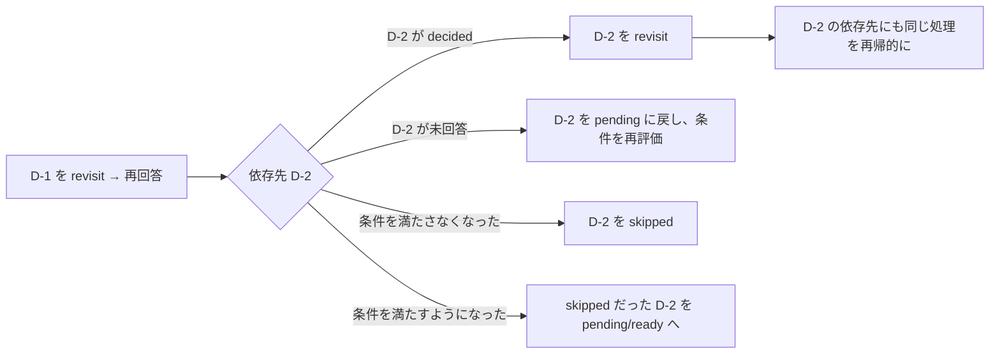

# Phase 3 設計: Decision Graph・サブエージェント・Claude への返却

> 作成日: 2026-11-14
> ステータス: 設計確定（実装前）。S-03 の結果で細部を見直す
> 関連: [requirements.md](../requirements.md) §4.3〜4.5 / [tasks.md](../tasks.md) Phase 3 / [ADR-0008](../adr/0008-agent-execution.md)

## 1. ユーザーと決めたこと（2026-11-14）

| #   | 論点                       | 決定                                                                                                                                                                           |
| --- | -------------------------- | ------------------------------------------------------------------------------------------------------------------------------------------------------------------------------ |
| P1  | サブエージェントの実行方式 | **インストール済みの `claude -p` を子プロセスで起動する**。今のログインとプランのまま使え、API キーは要らない（Agent SDK は原則 API キーの従量課金になるため見送り）→ ADR-0008 |
| P2  | Explorer をいつ動かすか    | **Deep Dive（`d`）のときだけ**。コストと待ち時間をユーザーが管理する                                                                                                           |
| P3  | 論点の洗い出しの起点       | **両方**。ユーザーが `dw plan "要求"` や TUI から Planner を動かす。Claude も作業中に MCP で論点を（依存関係つきで）積める                                                     |
| P4  | 決定を Claude に戻す方法   | **両方**。次のプロンプト送信時に Hook で新しい決定の要約を自動で添える。Claude は MCP でも過去の決定を引ける                                                                   |

## 2. 設計者判断で決めたこと

ユーザー判断が要らない（一般的な既定がある、または後から変えやすい）ものは次のように決めた。違和感があれば変える。

| #   | 論点                         | 決定                                                                                                                          | 理由                                                                                                                           |
| --- | ---------------------------- | ----------------------------------------------------------------------------------------------------------------------------- | ------------------------------------------------------------------------------------------------------------------------------ |
| D1  | Reviewer をいつ動かすか      | **手動のみ**（`dw review`、TUI の `r`）                                                                                       | P2 と同じくコストを管理するため。矛盾の検出は回答が増えてから価値が出る                                                        |
| D2  | 回答を変えたときの影響の伝播 | **LLM を使わず、Graph で機械的に行う**。依存先で決定済みのものは `revisit`、未回答のものは `pending` に戻す                   | 決定的で速く、テストできる。影響の「中身」の評価は Reviewer に任せる                                                           |
| D3  | 条件付き依存の表し方         | 「親の回答に、指定した選択肢のどれかが含まれるとき有効」だけにする                                                            | 構想資料の例（クラウドなら同期方式を聞く）を表せる最小の形。自由入力の値での条件は扱わない                                     |
| D4  | 前提が未決の論点             | `pending`（待ち）にして Current に出さない。前提がすべて決まったら `ready` に上げる                                           | 1件ずつ判断する体験を保つ。いまは使っていない `pending` 状態がここで意味を持つ                                                 |
| D5  | Explorer の結果の反映        | 既存の選択肢に推薦と理由を付ける。新しい選択肢の追加もできる（「Explorer の提案」と表示）。既存の選択肢は消さない             | `AskUserQuestion` 由来の質問は Claude が出した選択肢の文言で答える必要があるため。追加した選択肢は自由入力として Claude に届く |
| D6  | エージェントに渡すツール     | **読み取り専用**（Read / Grep / Glob / WebSearch / WebFetch）。Bash・Edit・Write は渡さない                                   | 調査に十分で、プロンプトインジェクション（NFR-09）の被害を抑えられる                                                           |
| D7  | コストの上限                 | 1回の実行に `--max-budget-usd`（既定 0.5 ドル）と `--max-turns`（既定 12）をかける。モデルは設定で変えられる（既定 `sonnet`） | 暴走を防ぐ。S-03 で観測した最大は $0.16・4 ターン                                                                              |
| D8  | 設定ファイル                 | `~/.decision-workspace/config.json` を Phase 3 で導入する。Phase 6 の振り分けモード（T-601）も同じファイルを使う              | 設定の置き場を1つにする                                                                                                        |

## 3. データモデルの追加

```text
decisions        + origin (ask | plan | manual), plan_id, blocked_by_count はビューで計算
dependencies     (decision_id, depends_on, when_options_json NULL=無条件)
plans            (id "P-n", request, source (user | claude), session_id, status, created_at)
explorations     (decision_id, run_id, summary, tradeoffs_json, created_at)   -- Deep Dive の結果。履歴として残す
agent_runs       (id, kind (planner | explorer | reviewer), target, model, status,
                  started_at, duration_ms, cost_usd, input_tokens, output_tokens, transcript_path, error)
deliveries       (session_id, decision_id, revision, delivered_at)  -- どのセッションにどの版を渡したか
```

- **origin**: `ask` は `AskUserQuestion` 由来（Hook が待っている）、`plan` は Planner や MCP で積んだもの（誰も待っていない）、`manual` は CLI で追加したもの。
- Option に `source`（`claude` / `explorer` / `user`）を足す。
- エージェントの全出力（transcript）は `.decision-workspace/runs/<run-id>.json` に保存し、DB には要約と計測値だけを入れる（AG-04）。

## 4. Decision Graph

### 4.1 登録

- 依存関係は、論点の作成と同時に（同じトランザクションで）登録する。Planner や MCP は、まだ ID のない論点同士を `key` で参照できる（例: `{ key: "sync", dependsOn: [{ key: "storage", whenOptions: ["cloud"] }] }`）。
- 循環は登録時に拒否する（DG-02）。既存の論点への依存も登録できる。

### 4.2 状態の決まり方（純粋関数として `packages/core` に置く）

```text
すべての前提が decided で、条件も満たす   → ready（Current に出る）
前提のどれかが未決                       → pending（Queue に「待ち: D-1」と出る）
前提は決まったが条件を満たさない          → skipped（理由: condition）
```

### 4.3 回答を変えたとき（D2）



- 過去の回答（Revision）は消さない（NFR-03）。
- `revisit` になった論点は、前の回答を残したまま Current に出る。
- TUI の History で、変更前後と影響を受けた論点を一覧できる（Decision Diff、DG-05）。

## 5. サブエージェント

### 5.1 実行基盤（`packages/agent-runner`）

```text
claude -p "<タスク文>"
  --model <設定>  --output-format stream-json --verbose
  --json-schema <Zod → JSON Schema（target: draft-7）>
  --tools "Read,Grep,Glob,WebSearch,WebFetch"  --allowedTools "Read,Grep,Glob,WebSearch,WebFetch"
  --max-turns 12  --max-budget-usd 0.5  --no-session-persistence
  --strict-mcp-config  --settings '{"disableAllHooks":true}'
  --append-system-prompt-file agents/<kind>.md
  (cwd = 対象プロジェクト)
```

S-03 の結果: 構造化出力は 9/9 成功、1 回 10〜20 秒・$0.05〜0.16。Explorer には「プロジェクトのファイルは前提であって根拠ではない。推薦の前に Web で現状を確かめる」と指示する（指示しないと設計書を言い直すだけになる）。

- 出力は Zod で検証してから保存する。検証に失敗したら1回だけやり直し、それでもだめなら失敗として記録する。
- **入力の扱い（NFR-09）**: 質問文や Claude 由来のテキストは、プロンプト内で「データ」として区切って渡し、命令として扱わないよう指示する。
- 実行は Daemon が管理する（同時実行数は既定 2）。キャンセルは子プロセスへの SIGTERM。
- 結果の JSON から、所要時間・費用・トークン数を `agent_runs` に記録する（AG-05）。

### 5.2 Planner（AG-01）

- 入力: 要求文。プロジェクトのファイルは読める。
- 出力: 論点の一覧（`key`、題名、質問文、入力の種類、候補の選択肢（任意）、依存関係）。選択肢が決めきれない論点は、選択肢なしの自由入力にしておき、あとで Deep Dive できる。
- 起点: `dw plan "要求"`、TUI の `p`（P3）。結果は Plan（`P-n`）としてまとめて登録する。

### 5.3 Explorer（AG-02、Deep Dive）

- 起点: TUI の `d`、`dw explore D-n`（P2）。**論点の状態は変えない**（`exploring` は使わない。2026-11-14 に変更）。実行中かどうかは `agent_runs` から判断し、TUI に進行中と表示する。調査中でも回答でき、回答済みになった論点には結果を履歴としてだけ残す。
- 出力: 要約、選択肢ごとの長所・短所、推薦とその理由、追加の選択肢の提案（D5）。
- **注意**: `AskUserQuestion` 由来の論点で Deep Dive すると、その間も Hook は待ち続ける。Hook の `timeout`（既定 600 秒）を超えると取り下げられるので、Deep Dive の前に TUI で残り時間を表示する。

### 5.4 Reviewer（AG-03、D1）

- 起点: `dw review`、TUI の `r`。対象はプロジェクトの決定済みの論点すべて（または Plan 単位）。
- 出力: 矛盾している決定の組と説明、見直しを勧める論点、追加を勧める論点。**提案だけ**を出し、TUI でユーザーが受け入れたものだけを反映する。
- 実装（T-310）: 提案は `proposals` テーブル（`RV-n`）に保存する。存在しない ID を挙げた提案や、もう決定済みでない論点だけを対象にした提案は保存時に捨てる。
  - 受け入れ: 矛盾・見直しは、挙がった論点のうち決定済みのものを `revisit` に戻す。追加は、挙がった論点を前提にした新しい論点を作る（Plan 単位のレビューならその Plan に入れる）。適用と受け入れの記録は1トランザクション。
  - 同じ対象（Plan またはプロジェクト全体）を再レビューすると、未処理の古い提案は `superseded` になる。
  - TUI: `r` で開始（実行中なら中止）。提案は History の上部に出し、`a` で受け入れ、`x` で却下。CLI: `dw review [--plan P-n]`、`dw proposals`、`dw accept|dismiss RV-n`。

## 6. Claude への返却（CC-07、P4）

### 6.1 次のプロンプトで自動で添える（UserPromptSubmit Hook）

- Claude Code がプロンプトを送るとき、Hook が Daemon に「このセッションにまだ渡していない決定」を問い合わせ、`additionalContext` で添える。
- 対象: `origin` が `plan` / `manual` の新しい決定、および**すべての論点の回答変更**（`AskUserQuestion` で答えたものを後でやり直した場合も含む）。`AskUserQuestion` での最初の回答は、すでにその場で Claude に届いているので除く。
- 形式（要点だけ、NFR-06 の上限つき）:

  ```text
  [Decision Workspace] 前回から決まったこと:
  - D-3 保存先 → SQLite（理由: オフラインで使う）
  - D-1 言語 → Rust に変更（前回: TypeScript）。影響: D-4, D-5 を再確認中
  未回答: 2 件（decision_list で確認できます）
  ```

  上限は 10 件または 2,000 文字。超えた分は件数だけ書き、MCP で引けることを示す。
- 渡した版は `deliveries` に記録し、同じ内容を二度渡さない。Daemon がいなければ何も添えない（フェイルオープン）。

### 6.2 MCP（`apps/mcp`、CC-04）

| ツール          | 内容                                                                      |
| --------------- | ------------------------------------------------------------------------- |
| `decision_ask`  | 論点を（依存関係つきで）積む。**待たずにすぐ返る**。返り値は割り当てた ID |
| `decision_list` | 未回答・決定済みの一覧（要約形式。件数上限つき）                          |
| `decision_get`  | 1件の詳細（決定、理由、Deep Dive の要約。全文の transcript は返さない）   |

- `dw install` が `.mcp.json` に MCP サーバーを、`.claude/settings.json` に UserPromptSubmit Hook を追加する。
- `AskUserQuestion`（待つ）と `decision_ask`（待たない）の使い分けを、MCP ツールの説明文で Claude に伝える。

## 7. TUI の変更

| 画面    | 変更                                                                                          |
| ------- | --------------------------------------------------------------------------------------------- |
| Current | 前提を表示（「前提: D-1 = クラウド」）。Explorer の推薦とトレードオフを表示。`d` で Deep Dive |
| Queue   | Plan ごとにまとめ、依存関係を字下げで表示。待ちの論点は「待ち: D-1」と表示                    |
| History | 変更前後と影響範囲（Decision Diff）。`r` で Reviewer、提案の受け入れ                          |
| 共通    | `p` で Plan の作成（要求文を入力）。エージェント実行中の表示と、`dw stats` 相当の費用表示     |

## 8. リスクと検証（S-03）

| リスク                                                                       | 検証・対策                                                                                                          |
| ---------------------------------------------------------------------------- | ------------------------------------------------------------------------------------------------------------------- |
| `--json-schema` の出力が安定しない                                           | S-03 で Planner・Explorer の形の出力を各数回試す。失敗時の再試行を実装                                              |
| 1回の実行が遅い・高い                                                        | S-03 で所要時間と費用を計測し、D7 の既定値を決める                                                                  |
| `claude -p` がユーザーの設定（CLAUDE.md、Hook、MCP）を読み込んで挙動が変わる | `--strict-mcp-config` と、Hook を無効にする方法を S-03 で確認。特に本ツール自身の Hook が再帰的に動かないようにする |
| Deep Dive 中に Hook が時間切れになる                                         | §5.3 の残り時間表示。必要なら `dw install --timeout` で延ばす                                                       |
