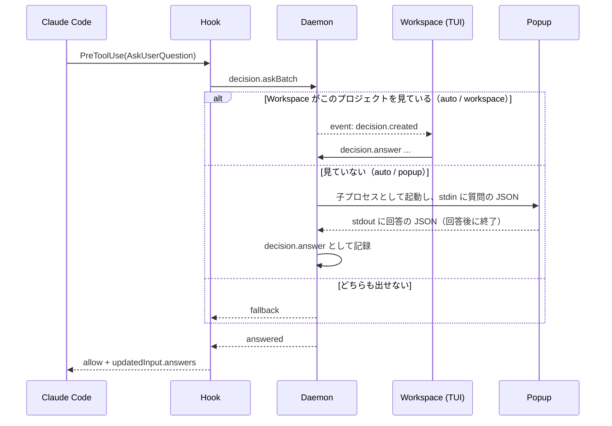

# UI モード設計案: Popup と Workspace

> 作成日: 2026-11-13
> ステータス: 提案（Phase 6。依存は Phase 2 のみなので、Phase 3 より前に回すこともできる）
> 対応 OS: **まず macOS に絞る**（2026-11-13 決定）。Windows は将来の拡張として、技術選定で道を残す
> 関連: [requirements.md](../requirements.md) §4.8 / [tasks.md](../tasks.md) Phase 6 / ADR-0006・0007（予定）

## 1. 背景

MVP では、質問は TUI に届く。TUI を開いていなければ Claude Code の通常 UI で聞かれる。この形だと、TUI を常に開いておく必要がある。気軽に使うには重く、1問だけ答えたい場面でもターミナルを切り替えることになる。

参考ツールは、これと違う2つの方向を取っている。

|                | AskHuman                                              | AUQ                                                  |
| -------------- | ----------------------------------------------------- | ---------------------------------------------------- |
| UI             | 質問が来るとネイティブのポップアップを開く（Tauri 2） | 別ターミナルの TUI で受信箱を常に表示する（OpenTUI） |
| 向いている場面 | 素早く答えて作業に戻る                                | 複数エージェントの質問をまとめてさばく               |

本ツールでは**両方を役割分担して持つ**。

## 2. 役割分担

|            | **Popup**（簡易回答画面）                                                        | **Workspace**（意思決定ワークスペース = TUI）                                                      |
| ---------- | -------------------------------------------------------------------------------- | -------------------------------------------------------------------------------------------------- |
| 目的       | 素早く答えて、すぐ元の作業に戻る                                                 | 腰を据えて検討し、複数セッションをまとめて管理する                                                 |
| 起動       | 質問が来たら自動で開き、答えたら閉じる                                           | ユーザーが開いて常駐させる                                                                         |
| 扱う範囲   | いま届いた1回分の質問（1〜4問）                                                  | 全プロジェクト・全セッションのキューと履歴                                                         |
| できること | 選択・複数選択・自由入力・スキップ・「ターミナルで答える」・「Workspace で検討」 | Popup の全機能に加えて、History・保留・理由の記録・やり直し。Phase 3 以降は Deep Dive と論点グラフ |
| 技術       | **Tauri 2**（画面は TypeScript / React。§6）                                     | OpenTUI（ADR-0002）                                                                                |

Popup は機能を絞った「入口」とする。深く考える必要がある質問は、Popup から Workspace に送れる。

## 3. 振り分けモード

質問をどの UI に出すかを、設定（ユーザー単位。プロジェクトごとに上書き可）で選ぶ。

| モード                   | 動作                                                                                    |
| ------------------------ | --------------------------------------------------------------------------------------- |
| `auto`（既定にする予定） | そのプロジェクトを Workspace が見ていれば Workspace に出す。見ていなければ Popup を開く |
| `workspace`              | Workspace だけを使う。見ていなければ Claude Code の通常 UI に戻す（現在の MVP の動作）  |
| `popup`                  | Workspace を開いていても、常に Popup を開く                                             |
| `off`                    | Hook は何もしない（Claude Code の通常 UI）                                              |

どのモードでも、最後の受け皿は Claude Code の通常 UI になる（Workspace → Popup → 通常 UI の順に落ちる）。

### 判断は Daemon が行う

いま Hook が渡している `requireViewer` を「表示先の要求」に置き換える。Daemon は `askBatch` を受けたとき、モードと接続中の UI から表示先を決める。

- **Popup は状態を持たないダイアログ**にする（§4.5）。Daemon が子プロセスとして起動し、stdin で質問を渡し、stdout で回答を受け取る。Popup は Daemon に接続しないので、Rust 側に IPC クライアントを書かずに済む。
- Popup プロセスが動いている間は「その質問を見ている UI」として数える。起動に失敗したとき、または一定時間内（例: 3秒）に「表示した」と報告してこないときは、通常 UI に戻す。
- Popup を開いている間に Workspace で答えてもよい。その場合、Daemon が Popup プロセスを終了させる。Claude Code 側で取り下げられた場合も同じ。

## 4. Popup の詳細

### 4.1 ライフサイクル

- **ウィンドウは同時に1つ**にする。Popup が開いている間に別の質問が届いたら、Daemon が順番待ちにする。いまの Popup が閉じたら、次の質問用に Popup を起動する。Popup には「あと N 件」を渡して表示させる（ウィンドウを乱立させない）。
- 1回の起動で扱うのは、1回分の質問（1〜4問）だけ。答え終わったら閉じる。
- 閉じるボタンと `Esc` は「ターミナルで答える」（fallback）として扱う。スキップは明示的なボタンで行う。
- Claude Code 側で `Esc` やタイムアウトが起きて質問が取り下げられたら、その質問を画面から消し、短く通知する。

### 4.2 表示内容

- どこから来た質問かを示す: プロジェクト名、セッション（短縮 ID）、届いた時刻
- 1問ずつ表示し、「1/3」のように何問目かを示す
- 選択肢の説明文を出す。推奨（`recommended`）があれば印を付ける
- 「Workspace で検討」ボタン: Workspace が起動しているときだけ有効にする（起動時に Daemon が可否を渡す）。押すと Popup を閉じ、質問は Workspace に移る（Hook は待ち続ける）

### 4.3 誤入力の防止（重要）

ターミナルで文字を打っている最中にウィンドウが前面に出ると、打った文字がそのまま回答として入ってしまう危険がある。次のどれにするかを S-07 で検証して決める。

| 案                      | 内容                                                                                                                            |
| ----------------------- | ------------------------------------------------------------------------------------------------------------------------------- |
| A. フォーカスを奪わない | 前面に表示するがキー入力は奪わない（Tauri の `focus: false`、macOS の非アクティブパネル）。通知と合わせ、クリックしてから答える |
| B. 入力を少し遅らせる   | フォーカスは移すが、表示後 0.5 秒はキー入力を無視する                                                                           |
| C. 確定に2段階を要求    | 選択したあと、もう一度 `Enter` を押して確定する                                                                                 |

### 4.4 キーボード操作

Workspace と同じ割り当てにする（数字キーで選択、`Enter` で確定、`Space` で複数選択の切り替え、`o` で自由入力、`s` でスキップ、`Esc` でターミナルに戻す）。マウス操作もできるようにする。

### 4.5 Daemon とのやり取り（stdin / stdout）

Popup は1行1メッセージの JSON でやり取りする。Rust 側は stdin / stdout と画面の橋渡しだけを行い、画面の中身は TypeScript で書く。

| 向き                     | メッセージ                 | 内容                                                                                                  |
| ------------------------ | -------------------------- | ----------------------------------------------------------------------------------------------------- |
| Daemon → Popup（stdin）  | `show`                     | 質問（1〜4問）、出どころ（プロジェクト・セッション・時刻）、「あと N 件」、「Workspace で検討」の可否 |
| Popup → Daemon（stdout） | `shown`                    | 画面に表示できた（表示待ちタイマーを止める）                                                          |
| Popup → Daemon（stdout） | `answer`                   | 各問の回答（選択した ID、自由入力）またはスキップ                                                     |
| Popup → Daemon（stdout） | `fallback` / `toWorkspace` | ターミナルで答える / Workspace で検討する                                                             |

- Popup は最後のメッセージを書いたら終了する。何も書かずに終了したら `fallback` とみなす。
- 取り下げや他の画面での回答は、Daemon が Popup に SIGTERM を送って閉じさせる。
- 画面の状態は `packages/core` の UI reducer を使う。メッセージのスキーマは `packages/protocol` に Zod で定義し、Daemon と Popup で共有する。

## 5. Workspace の拡張（マルチセッション）

いまの TUI は `-p` で指定した1つのプロジェクトしか見ない。AUQ のように、複数のセッションをまとめて扱えるようにする。

- `dw tui --all`: Daemon が知っているすべてのプロジェクトを表示する
- **プロジェクト登録簿**: Daemon は、一度でも使ったプロジェクトを `~/.decision-workspace/projects.json` に記録する（いまは起動中にメモリで持っているだけ）
- **セッション単位のまとまり**: Queue をプロジェクト → セッションの順にグループ化して表示する。切り替えやフィルタをキー操作でできるようにする
- **他プロジェクトへの着信**: 見ていないプロジェクトに質問が来たら通知する
- **放置された質問**: Hook が切断されたら取り下げる（実装済み）。加えて、長時間答えられていない質問を目立たせる
- **マウス操作**: OpenTUI はクリック・ドラッグ・ホイール・ホバーのイベントを標準で扱える（`useMouse`）。UI 状態は reducer にまとまっているので、マウス操作はキー操作と同じアクションに変換するだけで済む。

  | 操作                                       | 動作                                         |
  | ------------------------------------------ | -------------------------------------------- |
  | 選択肢をクリック                           | 選ぶ（複数選択では切り替え）                 |
  | 選択肢をダブルクリック／「確定」をクリック | 確定                                         |
  | 上部のタブをクリック                       | Current / Queue / History の切り替え         |
  | 下部のボタン行をクリック                   | 確定・自由入力・理由・スキップ・保留・通常UI |
  | Queue の行をクリック                       | その質問を開く                               |
  | ホイール                                   | 一覧のスクロール                             |

  マウスモード中はターミナルでのテキスト選択が `Option` を押しながらになるため、`m` キーと起動オプションで切り替えられるようにする。Popup（webview）も同じアクションを使うので、両者の操作感がそろう。

## 6. ネイティブウィンドウの技術: Tauri 2

**macOS に絞ったうえで Tauri 2 を採用する方向**とする（S-06 で確認して ADR-0006 で確定する）。

| 案                                                            | 長所                                                                                                                                                                          | 短所                                                                                                               | 判断                                          |
| ------------------------------------------------------------- | ----------------------------------------------------------------------------------------------------------------------------------------------------------------------------- | ------------------------------------------------------------------------------------------------------------------ | --------------------------------------------- |
| **Tauri 2**（AskHuman と同じ）                                | 画面は TypeScript / React で書け、`packages/core` の UI reducer を共有できる。安定版で実績がある。将来 Windows（WebView2）にも広げられる。`focus: false` でウィンドウを作れる | Popup のビルドに Rust のツールチェーンが必要。webview なので見た目は純ネイティブに一歩劣る                         | **採用候補**                                  |
| SwiftUI                                                       | macOS で最良の体験。フォーカス制御が確実                                                                                                                                      | UI ロジックを Swift で書き直す。Windows に広げるときは作り直し                                                     | 予備（フォーカス制御が Tauri で足りないとき） |
| TypeScript の webview ライブラリ（`@webviewjs/webview` など） | Bun から直接開ける                                                                                                                                                            | 中身は Tauri と同じ Rust 部品（tao / wry）を薄く包んだもの。beta で、ネイティブアドオンを Bun に読み込む部分が不安 | 不採用                                        |
| AppleScript                                                   | 依存ゼロ                                                                                                                                                                      | 説明文・複数問・「選択＋自由入力」が表現しにくい                                                                   | 不採用                                        |
| Electron                                                      | 実績がある                                                                                                                                                                    | 重い（起動時間・容量）                                                                                             | 不採用                                        |

Tauri を選ぶ理由:

- **UI ロジックの共有**: Workspace（TUI）と Popup が同じ reducer を使える。キー操作や回答の検証が二重実装にならない。
- **Rust の部分を最小にできる**: Popup を状態を持たないダイアログにする（§4.5）ので、Rust 側は stdin / stdout と画面の橋渡しだけになる。
- **将来の Windows**: 方針を変えずに広げられる（SwiftUI だと作り直し）。

S-06 で確かめること:

- 質問が届いてから**表示されるまで 500ms 以内**か
- `focus: false` や非アクティブパネルで、キー入力を奪わずに表示できるか（§4.3 案A）。足りなければ SwiftUI に切り替える
- 日本語 IME での自由入力
- stdin / stdout のやり取りが Tauri で素直に書けるか
- バイナリのサイズと、開発環境の準備（rustup）の手間

## 7. 未決事項

| #   | 論点                                                               | 決める時期                                                               |
| --- | ------------------------------------------------------------------ | ------------------------------------------------------------------------ |
| U1  | 既定モードを `auto` にするか                                       | 実際に使ってみてから                                                     |
| U2  | Popup で「理由の記録」や「保留」を許すか（簡易さとのトレードオフ） | T-603 着手前                                                             |
| U3  | 誤入力防止の方式（§4.3）                                           | ✅ 案 A（フォーカスを奪わない）（2026-11-14、S-07）                      |
| U4  | ネイティブウィンドウの技術（§6）                                   | ✅ Tauri 2（ADR-0006）                                                   |
| U5  | Windows / Linux の対応範囲                                         | ✅ まず macOS のみ（2026-11-13）。Windows は将来                         |
| U6  | Popup を Daemon が起動するか、常駐の小さなアプリにするか           | Daemon が質問ごとに起動する方向（§4.5）。S-06 で起動が遅ければ常駐を検討 |
