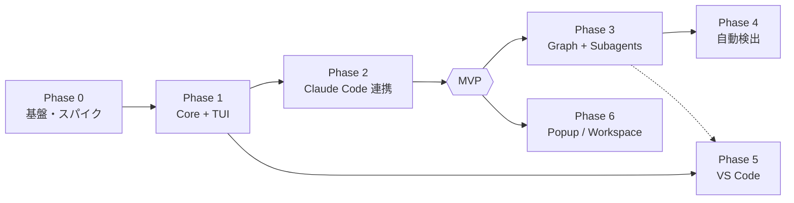

# タスク分解

> 作成日: 2026-11-13
> 参照: [requirements.md](requirements.md) / [tech-stack.md](tech-stack.md)

- ID 体系: `T-<phase><連番>` = 実装タスク、`S-<連番>` = 検証スパイク（捨ててよいコード）
- 「依存」が完了するまで着手しない。「完了条件」を満たしたら ⬜ を ✅ にする。
- Phase 0〜3 は着手単位まで分解した（Phase 3 は 2026-11-14）。Phase 4 以降は着手前に再分解する。S-03 は Phase 3 の先頭に移した。

## 全体の流れ

MVP は Phase 2 完了時点（`AskUserQuestion` を TUI で1件ずつ回答できる状態）。

---

## Phase 0 — 基盤整備と検証スパイク

| ID       | タスク                                                                                                         | 依存  | 完了条件                                                                                                                              |
| -------- | -------------------------------------------------------------------------------------------------------------- | ----- | ------------------------------------------------------------------------------------------------------------------------------------- |
| ✅ T-001 | jj（colocated）初期化、ドキュメント整備                                                                        | —     | `docs/` 一式と `CLAUDE.md` がコミットされている                                                                                       |
| ✅ T-002 | Bun workspaces の雛形（`apps/*`, `packages/*`）、tsconfig（strict）、Biome、`bun test`                         | —     | `bun run check`（lint + 型検査 + テスト）が空プロジェクトで通る                                                                       |
| ✅ T-003 | `protocol` / `core` がランタイム非依存であることを型検査で担保する仕組み（Bun/Node 型定義なしで tsc）          | T-002 | `bun:*` を import すると `bun run typecheck` が落ちる                                                                                 |
| ✅ S-01  | **Hook 往復スパイク**: `PreToolUse(AskUserQuestion)` で外部プロセスの回答を待ち、`updatedInput.answers` で返す | —     | 単一・複数選択・複数問で回答が Claude に届く。待機中の Claude Code の表示、Esc によるキャンセル、タイムアウト時の挙動を記録（Q1, Q2） |
| ✅ S-02  | **OpenTUI スパイク**: React 版で Current 画面＋キー操作＋外部イベントによる再描画                              | T-002 | ADR-0002 を Accepted にできる判断材料がそろう（Q3）                                                                                   |
| ✅ S-04  | **Hook 起動速度計測**: `bun run` と `bun build --compile` の比較                                               | S-01  | NFR-05（100ms）を満たす方式を決定（Q5）                                                                                               |
| ⬜ S-05  | 参考ツール（AUQ ほか）のライセンス・メンテ状況調査                                                             | —     | `docs/research/prior-art.md` に結果を記載（Q6）                                                                                       |

S-01 の結果、Hook で回答を待つ方式は実用になると分かり、ADR-0004 を確定した（2026-11-13）。

S-05 は保留（2026-11-14）。参考ツールのコードは流用せず、アイデアだけを参考に自前で実装しているため、今は調べる必要がない。参考ツールのコードを借りたくなったとき（Phase 6 の Popup で AskHuman を参考にする場合など）か、OSS として公開する前に行う。

---

## Phase 1 — Decision Core + TUI

| ID       | タスク                                                                                    | 依存         | 要件                | 完了条件                                            |
| -------- | ----------------------------------------------------------------------------------------- | ------------ | ------------------- | --------------------------------------------------- |
| ✅ T-101 | `protocol`: Decision / Option / Revision / Session の Zod スキーマ、JSON-RPC メソッド定義 | T-002        | DQ-01, DQ-02        | スキーマから型が生成され、無効入力のテストがある    |
| ✅ T-102 | `core`: 状態遷移マシン（許可された遷移表）、Revision 追加ロジック                         | T-101        | DQ-03, DQ-05, DQ-06 | 全遷移の正常系と不正遷移のテスト                    |
| ✅ T-103 | `storage`: SQLite スキーマ、マイグレーション、リポジトリ、楽観ロック付き確定              | T-101        | DQ-04, DQ-07, DQ-08 | 同時確定で片方が競合エラーになるテスト（NFR-02）    |
| ✅ T-104 | `daemon`: UDS サーバー（0600）、JSON-RPC ディスパッチ、イベント通知                       | T-102, T-103 | DQ-09, NFR-07       | 2クライアント接続で片方の更新がもう片方に通知される |
| ✅ T-105 | `ipc-client`: 接続、オンデマンド起動、再接続、タイムアウト                                | T-104        | —                   | Daemon 停止中の呼び出しで自動起動される             |
| ✅ T-106 | `cli`: `dw add / list / answer / show`（非対話）                                          | T-105        | UI-06               | CLI だけで登録〜回答〜履歴確認ができる              |
| ✅ T-107 | `tui`: Current 画面、選択・確定・保留・スキップ・戻る                                     | T-105, S-02  | UI-01, UI-04, DQ-02 | 3種の入力タイプを TUI で回答できる                  |
| ✅ T-108 | `tui`: Queue / History 画面、`Tab` 切替、`?` ヘルプ                                       | T-107        | UI-02, UI-03, UI-04 | 決定済みの理由と過去 Revision が見られる            |
| ✅ T-109 | `tui`: 新規 Decision の通知                                                               | T-107        | UI-05               | CLI で add すると TUI に即時反映される              |
| ✅ T-110 | 中断再開の統合テスト                                                                      | T-106        | NFR-01              | 10件中5件回答 → Daemon 再起動 → 残り5件から再開     |

---

## Phase 2 — Claude Code 連携（MVP）

| ID       | タスク                                                                                                                 | 依存              | 要件          | 完了条件                                                     |
| -------- | ---------------------------------------------------------------------------------------------------------------------- | ----------------- | ------------- | ------------------------------------------------------------ |
| ✅ T-201 | `hook`: `PreToolUse` エントリ。stdin の質問を `decision.askBatch` に渡し、回答で `updatedInput` を組み立てる           | T-105, S-01, S-04 | CC-01, CC-02  | 実際の Claude Code で質問が TUI に出て、回答が Claude に届く |
| ✅ T-202 | フェイルオープン: 接続失敗・タイムアウト・TUI 側の「ターミナルで答える」操作で何も出力せず終了                         | T-201             | CC-03, NFR-04 | 故障注入テスト（Daemon kill、ソケット削除、応答遅延）        |
| ✅ T-203 | セッション管理: `session_id` / `cwd` から Session とプロジェクトを特定、再接続時の紐付け                               | T-201             | CC-05, DQ-08  | 2つの Claude セッションの質問が混ざらない                    |
| ✅ T-205 | `dw install / uninstall`: `.claude/settings.json` の hooks を追記・削除（既存設定を壊さない。MCP 設定は T-311 で追加） | T-201             | CC-06         | 既存設定のある JSON に対して冪等に追加・削除できる           |
| ✅ T-206 | E2E: `claude -p` ＋ hook でのシナリオテスト（可能な範囲で自動化）                                                      | T-205             | —             | CI またはローカルスクリプトで再現できる                      |
| ✅ T-207 | ログ方針: 質問本文の出力抑制、デバッグフラグ                                                                           | T-201             | NFR-08        | デフォルトログに質問本文・回答が含まれない                   |

---

## Phase 3 — Decision Graph + サブエージェント + Claude への返却

設計: [design/phase3.md](design/phase3.md)。決定事項 P1〜P4（ユーザー判断）と D1〜D8（設計者判断）は設計書 §1・§2。

| ID       | タスク                                                                                                                                                                                                                                  | 依存               | 要件                 | 完了条件                                                                          |
| -------- | --------------------------------------------------------------------------------------------------------------------------------------------------------------------------------------------------------------------------------------- | ------------------ | -------------------- | --------------------------------------------------------------------------------- |
| ✅ S-03  | **`claude -p` エージェントのスパイク**: `--json-schema` で Planner / Explorer 形の出力を各3回取り、成功率・所要時間・費用を記録。本ツールの Hook を無効にして起動する方法、`--strict-mcp-config` の挙動を確認 → ADR-0008 を Accepted に | —                  | AG-04〜06            | 計測値が設計書 D7 の既定値を決められるだけそろう                                  |
| ✅ T-301 | データモデル: `dependencies` / `plans` / `explorations` / `agent_runs` / `deliveries`、`origin`・`plan_id`、Option の `source`。マイグレーション 002 と protocol のスキーマ                                                             | —                  | DG-01, AG-05         | 既存 DB が移行でき、既存テストが通る                                              |
| ✅ T-302 | core Graph: 循環検出、前提による `pending`/`ready`/条件 `skipped` の判定、回答変更時の伝播（純粋関数）                                                                                                                                  | T-301              | DG-02〜04, DG-06     | 菱形・多段・条件の切り替わりを含む単体テスト                                      |
| ✅ T-303 | Store / Daemon: 依存つきの一括登録（`key` 参照）、回答・やり直し時に Graph の結果を同じトランザクションで適用し、イベントを流す                                                                                                         | T-302              | DG-01〜04, DG-06     | 統合テスト: 親の回答で子が ready / skipped になり、やり直しで revisit が伝播する  |
| ✅ T-304 | CLI: `dw add --after D-1[=1,2]`、`dw show` で前提と依存先、`dw diff D-n`                                                                                                                                                                | T-303              | DG-05                | CLI だけで依存つきの論点を作り、やり直しの影響を確認できる                        |
| ✅ T-305 | TUI: Current の前提表示、Queue の Plan ごとの字下げと「待ち」表示、History の Decision Diff                                                                                                                                             | T-303              | DG-05, UI-02, UI-03  | TUI の E2E テスト                                                                 |
| ✅ T-306 | 設定ファイル `~/.decision-workspace/config.json`（モデル、予算、ターン数、同時実行数）と `dw config get/set`。Phase 6 の T-601 と共用                                                                                                   | —                  | CF-01                | 不正な値を拒否するテスト                                                          |
| ✅ T-307 | `agent-runner`: `claude -p` の起動、Zod → JSON Schema、読み取り専用ツール、上限、transcript の保存、`agent_runs` の記録、キャンセル、同時実行数の制御、再試行                                                                           | S-03, T-301, T-306 | AG-04〜06            | 偽の `claude` コマンドで成功・検証失敗・タイムアウト・キャンセルをテスト          |
| ✅ T-308 | Explorer: `agents/explorer.md` と出力スキーマ、`decision.explore`、結果の反映（推薦・理由・追加の選択肢）、`dw explore`、TUI の `d`（実行中表示、Hook の残り時間表示）                                                                  | T-307              | AG-02, UI-07         | 偽 `claude` での統合テストと、`bun run e2e` に実モデルのケースを1つ               |
| ✅ T-309 | Planner: `agents/planner.md` と出力スキーマ、`dw plan "要求"`、TUI の `p`、Plan の一括登録                                                                                                                                              | T-307, T-303       | AG-01                | 同上                                                                              |
| ✅ T-310 | Reviewer: `agents/reviewer.md`、`dw review`、TUI の `r`、提案の表示と受け入れ                                                                                                                                                           | T-307, T-303       | AG-03                | 同上                                                                              |
| ✅ T-311 | MCP サーバー（`apps/mcp`、stdio）: `decision_ask`（待たない・依存つき）/ `decision_list` / `decision_get`。`dw install` が `.mcp.json` に追加                                                                                           | T-303              | CC-04, CC-10         | MCP クライアントからの統合テスト、`bun run e2e` に1ケース                         |
| ✅ T-312 | UserPromptSubmit Hook: 未配達の決定・変更の要約を `additionalContext` で添える（上限つき）、`deliveries` の記録、`dw install` が追加                                                                                                    | T-303              | CC-07, CC-09, NFR-06 | 同じ内容を二度渡さない、上限を超えたら件数だけ、Daemon なしで何もしない、のテスト |
| ✅ T-313 | 計測: `dw stats`（エージェントの実行回数・費用・トークン、返却したコンテキストのサイズ）                                                                                                                                                | T-307, T-312       | NFR-10               | 数値が `agent_runs` / `deliveries` と一致する                                     |
| ✅ T-314 | TUI の Graph 画面（4つ目のタブ）: Plan ごとに全論点（決定済み・未回答・待ち・スキップ）を木で表示し、状態の色・決まった回答・条件・自動スキップの理由を出す。行から回答・Deep Dive・やり直しができる                                    | T-305              | DG-07                | TUI の E2E: 条件で消えた枝と決定済みの枝が1画面で見える                           |
| ✅ T-315 | `dw graph [--plan P-n] [--format text\|mermaid]`: テキストの木、または Mermaid（状態ごとの色、条件をエッジのラベルに）                                                                                                                  | T-303              | DG-07                | 出力のスナップショットテスト。Mermaid が構文として正しい                          |

着手順の目安（2026-11-14 改訂）: 済 S-03・T-301〜T-308。次は T-311・T-312（MCP と Claude への返却。大量の論点を待たずに積めるようにする）→ T-314・T-315（グラフ全体の表示）→ T-309・T-310（Planner・Reviewer）→ T-313（計測）。

## Phase 4 — 自動検出（概略）

| ID    | タスク                                                                   | 要件          |
| ----- | ------------------------------------------------------------------------ | ------------- |
| T-401 | `Stop` Hook で `last_assistant_message` を取得し、ルールベースで候補検出 | DT-01         |
| T-402 | 曖昧な候補の LLM 判定（外部テキストはデータとして扱う）                  | DT-02, NFR-09 |
| T-403 | 重複照合                                                                 | DT-03         |
| T-404 | 通知のみ → オプトインで介入、の設定                                      | DT-04, DT-05  |
| T-405 | Managed Mode の実現可能性検証（`defer` ＋ `--resume`）                   | —             |

## Phase 5 — VS Code 拡張（概略）

| ID    | タスク                                          | 要件  |
| ----- | ----------------------------------------------- | ----- |
| T-501 | 拡張の雛形、`ipc-client` の Node 対応確認       | VS-02 |
| T-502 | サイドバー Webview（Current / Queue / History） | VS-01 |
| T-503 | 通知                                            | VS-04 |
| T-504 | 論点グラフ表示（Phase 3 完了後）                | VS-03 |

---

## Phase 6 — UI モード: Popup と Workspace（概略）

設計案: [design/ui-modes.md](design/ui-modes.md)。依存は Phase 2 のみなので、Phase 3 より前に回すこともできる。対応 OS はまず macOS のみ。Popup は Tauri 2 の方向（S-06 で確認）。

| ID    | タスク                                                                                                                                                                                                                                                        | 依存         | 要件                |
| ----- | ------------------------------------------------------------------------------------------------------------------------------------------------------------------------------------------------------------------------------------------------------------- | ------------ | ------------------- |
| S-06  | **Tauri 2 の検証スパイク（macOS）**: stdin で質問を受けて stdout で回答を返す「1問の質問ウィンドウ」を作り、表示までの時間・IME・`focus: false` の挙動・バイナリサイズ・rustup の手間を確かめる → ADR-0006。フォーカス制御が足りなければ SwiftUI を予備とする | —            | PU-01, PU-07        |
| S-07  | **フォーカスと誤入力のスパイク**: ターミナルで入力中に Popup が出たときの挙動を、§4.3 の案 A〜C で比べる                                                                                                                                                      | S-06         | PU-06               |
| T-601 | 振り分けモードの設定（ユーザー設定ファイル＋プロジェクト上書き、`dw config get/set mode`）                                                                                                                                                                    | —            | UM-01               |
| T-602 | Daemon の振り分け: `requireViewer` を表示先の要求に置き換え、Popup の起動（子プロセス）・表示待ちタイマー・順番待ち・取り下げ時の終了・フォールバックを実装 → ADR-0007                                                                                        | T-601        | UM-02, UM-03        |
| T-603 | Popup 本体（Tauri 2、画面は TypeScript / React）: stdin / stdout のメッセージ（`packages/protocol` に定義）、1問ずつの回答・スキップ・ターミナルで答える。UI 状態は `packages/core` の reducer を共有                                                         | S-06, T-602  | PU-01, PU-04        |
| T-604 | Popup: 順番待ち、出どころの表示、「Workspace で検討」                                                                                                                                                                                                         | T-603        | PU-02, PU-03, PU-05 |
| T-605 | Popup: 誤入力防止（S-07 の結論を実装）                                                                                                                                                                                                                        | S-07, T-603  | PU-06               |
| T-606 | Workspace: プロジェクト登録簿と `dw tui --all`                                                                                                                                                                                                                | —            | WS-01, WS-02        |
| T-607 | Workspace: プロジェクト・セッション単位のグループ化と絞り込み、他プロジェクトへの着信通知、放置された質問の強調                                                                                                                                               | T-606        | WS-03, WS-04        |
| T-609 | Workspace: マウス操作（OpenTUI の `useMouse`）。クリック・ダブルクリック・ホイール・ホバーを UI reducer の既存アクションに対応させ、画面下部にボタン行を追加。`m` キーと起動オプションでマウスモードを切り替え。`mockMouse` でテスト                          | —            | WS-05               |
| T-608 | テスト: 振り分けの統合テスト（Workspace あり／なし／Popup 起動失敗）、Popup の E2E                                                                                                                                                                            | T-602, T-603 | —                   |

## 横断タスク

| ID       | タスク                                                                                                                                                              | タイミング                     |
| -------- | ------------------------------------------------------------------------------------------------------------------------------------------------------------------- | ------------------------------ |
| ✅ T-X01 | CI（GitHub Actions）: lint / 型検査 / テスト（macOS, Linux）。あわせて配布の準備（ADR-0009: 単一バイナリ、release ワークフロー、Homebrew formula、LICENSE、README） | リモートリポジトリ作成時       |
| T-X02    | メトリクス収集（操作回数、エージェント起動回数、トークン）                                                                                                          | Phase 2 から段階的に（NFR-10） |
| T-X03    | Decision Export（Markdown / ADR 出力）                                                                                                                              | Phase 3 以降                   |
